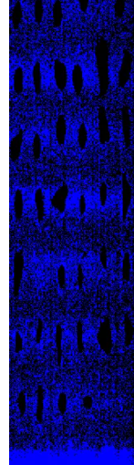

# TFM
El proyecto consistía en el desarrollo y optimización de un flujo de trabajo para la identificación de de imagenes hiperspectrales.
El trabajo utilizaba imágenes adquiridas con una cámara SWIR de SPECIM, que generaba archivos con extensión .hdr y sus correspondientes datos asociados.
Este proyecto consiste en una adaptación del flujo de trabajo a Python mediante las bibliotecas scikit-learn, pandas y numpy. Por tanto, no se analizarán en detalle las razones detrás de las decisiones metodológicas.

Existen algunas diferencias respecto al trabajo original, entre ellas:
* La compresión de las imágenes se realizaba después del preprocesamiento.
* Aqui no se guardan los modelos entrenados.
* Los modelos no se utilizaron para predecir muestras desconocidas.
* El flujo de trabajo no es exactamente igual al original. En esta versión se implementó una verdadera pipeline, en lugar de ejecutar una secuencia de pasos independientes.
* Seleccion automactica de componentes. Originalmente el numero de componentes se selecciono manualmente, algo que sigue siendo mas fiable.

La mayoria de las diferencias en este repositorio ienen como objetivo acelerar el proceso.

La estructura de este proyecto es:
* **-src:** 
    Contiene el código fuente de la adaptación a Python.
* **-Work:** 
    Contiene los notebooks en los que se llevó a cabo una recreación del Trabajo de Fin de Máster. 
    En el trabajo original, el número de componentes se optimizó manualmente: las variables latentes para PLS-DA y los componentes principales para cada clase en SIMCA. Para ello, se utilizaron métricas como la sensibilidad, el error y la tasa de asignación, en lugar de emplear una pipeline que optimizara automáticamente el número de componentes.
    Sin embargo, en esta recreación se observó que la pipeline seguía seleccionando más componentes de los elegidos manualmente en el trabajo original, especialmente al combinar los preprocesamientos Savitzky-Golay (Sav-Gol) y Standard Normal Variate (SNV).
    En este último caso, dos componentes eran más que suficientes, ya que el error era inferior o igual al 1 % y la tasa de asignación era igual o superior al 99 %.

## src
#### **-adecuacion.py**
Funciones que contiene:

- **`corrector(ruta_imagen: str, ruta_negro: str, ruta_blanco: str)`**: recibe las rutas de tres archivos `.hdr` (imagen de la muestra, referencia negra y referencia blanca) y devuelve un array tridimensional con los espectros corregidos y un array con las longitudes de onda.

- **`img2matrix(img: np.ndarray) -> np.ndarray`**: convierte una imagen o un array tridimensional de dimensiones `(H, W, B)` en una matriz bidimensional de dimensiones `(H * W, B)`. Este proceso se conoce como *unfurling*. Existe una implementación adicional específica para la clase correspondiente.

- **`matrix2img(mat: np.ndarray, h: int, w: int, b: int)`**: convierte una matriz bidimensional de dimensiones `(H * W, B)` en un array tridimensional de dimensiones `(H, W, B)`, siempre que las dimensiones sean compatibles. Este proceso se conoce como *furling*. Existe una implementación adicional específica para la clase correspondiente.

- **`replace_from_coords(img: np.ndarray, coords: np.ndarray, new_value: int | float = 0) -> np.ndarray`**: reemplaza los valores de una imagen en las coordenadas indicadas mediante un array de coordenadas `np.array([[row, col], ...])`, asignándoles el valor especificado en `new_value`.

- **`ImagenHyper(img: np.ndarray, WV: np.ndarray, mask=None, ylabels=None)`**: clase diseñada para simplificar la gestión de datos hiperespectrales.

  **Parámetros de entrada:**
  - `img`: imagen hiperespectral almacenada en un `np.ndarray` tridimensional.
  - `WV`: array de longitudes de onda (`Wavelength`).
  - `mask` (opcional): array booleano bidimensional (`np.ndarray`) que indica los píxeles de interés. Si no se proporciona, se genera una máscara que incluye todos los píxeles.
  - `ylabels` (opcional): etiquetas de clase asociadas a los datos.

  **Propiedades de la clase:**

  - **`shape`**: devuelve las dimensiones de la imagen.
  - **`WV`**: devuelve las longitudes de onda.
  - **`coords`**: devuelve las coordenadas de los píxeles en el mismo orden que los espectros, en formato `[row, col]`.
  - **`spectra`**: devuelve los espectros en un `np.ndarray`.
  - **`img`**: devuelve el array tridimensional de la imagen.
  - **`mask`**: devuelve un array booleano bidimensional en el que `True` identifica los píxeles de interés y `False` los excluidos.
  - **`is_labeled`**: devuelve un valor booleano que indica si la imagen tiene datos etiquetados.
  - **`y_labels`**: devuelve un array unidimensional con las etiquetas de clase.
  - **`labelled_coords`**: devuelve las coordenadas de los píxeles etiquetados, en formato `[row, col]`.
  - **`labelled_spectra`**: devuelve los espectros correspondientes a los píxeles etiquetados, en el mismo orden que `y_labels`.

  **Funciones de la clase:**

  - **`add_label(y_labels, labelled_coords)`**: añade las etiquetas de clase (`y_labels`), las coordenadas correspondientes (`labelled_coords`) y los espectros asociados (`labelled_spectra`). Este proceso puede realizarse fácilmente mediante las funciones del módulo `labelling`.
  - **`_update_mask_data()`**: actualiza los datos de la imagen asociados a la máscara.
  - **`add_mask()`**: añade una máscara a la imagen.
  - **`slicer(modo="auto" | "manual", fila_ini=None, fila_fin=None, col_ini=None, col_fin=None, margin=5)`**: recorta una región de la imagen. Dispone de dos modos de funcionamiento:
    - **`manual`**: recorta una región rectangular a partir de las coordenadas proporcionadas.
    - **`auto`**: si existe una máscara, recorta la imagen para eliminar la mayor parte posible de los píxeles excluidos por ella.

#### **-labeling.py**
Funciones que contiene:

- **`identificar_muestras1(img: ImagenHyper)`**: devuelve el número de plásticos identificados (`n_plasticos`) y los objetos detectados.

- **`add_spect(wv, espectro, name, fig)`**: añade un espectro a una figura de Seaborn.

- **`espectros_muestras(props, img, preprocesado:str="RAW")`**: muestra el espectro medio de cada muestra identificada en `props`. Entre los preprocesamientos disponibles se encuentran sin y SNV.

- **`enseñar_muestras(props, img, preprocesado: str = "RAW")`**: genera una figura en la que se muestra el número asignado a cada muestra, comenzando por 0. Necesita la máscara y el objeto `props`.

- **`y_prop_label_generation(n)`**: genera un array con las etiquetas de clase para las muestras identificadas, con el mismo número de elementos que muestras.

- **`combinar_labels(imagen: "ImagenHyper", y_prop_label: np.array, props: list)`**: añade las etiquetas a la imagen hiperespectral. Las muestras de la clase 0 se ignoran.

#### **-PLSDA_BAYES.py**
Funciones que contiene:
- *``PLSDA``* clase
Añade el clasificador PLS-DA. Utiliza una implementacion similar al de *classification-toolbox*.
Funciona como un clasificador de sklearn. Es mas un wrapper que una clase completamente nueva.

  **Propiedades de la clase**
  - **``n_components``**: nº de componentes que va utilizar. Por defecto 2.
  - **``scale``**: No implementado aun.
  - **``max_iter``**: numero de iteraciones que realiza el modelo. por defecto 500.
  - **``pls``**: modelo pls.
  - **``scaler``**: No implementado aun.
  - **``label_encoder``**: No implementado aun.
  - **``classes_``**: Clases unicas de y.
  - **``thr``**: Lista con los umbrales de selección.
  **Funciones de la clase**
  - **``transform (X)``**:
  - **``fit(X, y)``**:
  - **``find_thr(X, y)``**:
  - **``fit_transform(X, y)``**:
  - **``predict_proba(X, y)``**:
  - **``predict(X, y)``**:

#### **-preprocesado.py**
Codigo reduntante
Funciones que contiene:
* **snv:**     Finalmente no se utilizo cube: (H, W, B) devuelve: (H, W, B).

#### **-rgb.py**
Funciones que contiene:
* **``img_rgb()``:** Genera images de Falso RGB. Permite cambiar el color cambiando en que vandas se fijas el rgb.
* **``imagen_prediccion()``:** Genera una imagen si se le das las los datos en forma de labes, coodenadas [row, col], y forma. Si tiene out devuelte array de la imagen.Actualmente solo funciona con tres clases +0.
* **``imagen_labelling()``:** Enseña la imagen con el numero de muestras. Necesita Props identidad de prop y la imagen original. Si tiene out devuelte array de la imagen. Actualmente solo funciona con tres clases +0.

#### **-prop_shuffling.py** (WIP)
Este codigo no se utilizo originalmente en el TFM, pero se penso que podria resultar util para proyectos similares.
Añade dos funciones diseñadas para combinar muestras (llamados props) de distintos datasets.
Para ejecutar este codigo es necesario utilizar funciones en labelling y la clase de datos Imagenhyper.

* **``combinador_props( ,split: float = 0.3, seed: int = None)``**: Mezcla aleatoriamente y divide varias listas de props. Devuelve 2 listas. Opcion de cambiar el split y la semilla.
* **``combinador_props_clase()``**:     Mezcla y divide varias listas de props manteniendo la proporción de clases de sus respectivos arrays ys. Tanto props como ys son listas de listas.

#### `SIMCA.py`

##### *SIMCA*

Implementa el clasificador SIMCA mediante una implementación de ALT-SIMCA similar a la de *Classification Toolbox*.

Funciona como un clasificador de una sola clase (*one-class classifier*) compatible con `scikit-learn`.

Primero, se inicializa el modelo y se especifican el número de componentes principales del PCA, el número de iteraciones y la etiqueta numérica de la clase que se desea predecir.
**Propiedades de clase**
- **`n_components`**:lista con los componentes de cada clase. Si no se introduce cada clase usara 2 componentes principales
- **`max_iter`**: numero de iteraciones que tiene que realizar el PCA por defecto 100
- **`.thr`**: devuelve una lista con los umbrales de clasificación de cada modelo.
**Funciones de clase**
- **`.fit(X, y)`**: entrena el modelo y calcula el umbral óptimo de clasificación. Busca el umbral que permita equilibrar la sensibilidad y la especificidad. Si no es posible encontrar un equilibrio, prioriza la sensibilidad.
- **`.thr`**: devuelve el umbral de distancia utilizado para la clasificación.
- **`.loadings()`**: devuelve los pesos (*loadings*) del modelo PCA.
- **`.predict_distance(X)`**: calcula la distancia combinada mediante la fórmula:
  $ \sqrt{T hot^2 + q res^2} $
  Combina la distancia asociada al espacio de componentes principales con la distancia residual.
- **`.predict(X)`**: calcula la distancia combinada y la compara con el umbral de clasificación.

##### *Multi-SIMCA*

Permite entrenar y gestionar varios modelos ALT-SIMCA dentro de un mismo objeto.

Al igual que en SIMCA, se deben especificar el número de componentes principales y el número de iteraciones del PCA.
**Propiedades de clase**
- **`n_components`**:lista con los componentes de cada clase. Si no se introduce cada clase usara 2 componentes principales
- **`max_iter`**: numero de iteraciones que tiene que realizar el PCA por defecto 50
- **`.mode`**: determina cómo se devuelven las predicciones. Actualmente, admite los siguientes modos:
    - **`Soft`**: devuelve un array en el que cada fila corresponde a una clase y cada columna a una muestra. Permite aprovechar al máximo la información proporcionada por SIMCA. Este es el metodo que se uso originalmente en el TFM.
    - **`Inter`**: asigna a cada muestra la clase más cercana en relación con su umbral de clasificación. Es el modo predeterminado.
    - **`Hard`**: solo clasifica las muestras que pertenecen exclusivamente a una clase. Las muestras que pertenecen a varias clases o no pertenecen a ninguna se etiquetan como `-1`.
- **`models_`**: lista con los modelos oneclass. Usan clase SIMCA.
- **`.thr`**: devuelve una lista con los umbrales de clasificación de cada modelo.
**Funciones de clase**
- **`.fit(X, y)`**: entrena todos los modelos.
- **`.predict(X)`**: clasifica las muestras utilizando los modelos entrenados, según el modo de predicción seleccionado.
- **`.loadings()`**: devuelve una lista que contiene los *loadings* de cada modelo.

#### **-spatial_bin.py**
* **``binning_mask(mask, factor=2)``:** Realiza una compresión espacial de array booleano  y devuelve: (H//factor, W//factor, B)
* **``binning_hsi(cube, factor=2)`:** Realiza una compresión espacial de cube: (H, W, B) y devuelve: (H//factor, W//factor, B)
* **``binning (cube:"ImagenHyper", factor:int=2)``**: Devuelve una ImagenHyper devuelve: (H//factor, W//factor, B)

## `Work`

### Contenido

- **`prep_[playa].ipynb`**: estos cuadernos son muy similares entre sí. En ellos se realiza la importación y compresión de los datos, así como un breve análisis exploratorio. No fue necesario realizar un análisis completo, ya que este se había llevado a cabo durante el TFM. Para ello, se utilizaron las funciones desarrolladas en `src/`. El proceso se realizó por separado para cada playa. Tras etiquetar las muestras, los datos se guardaron en archivos *pickle* como objetos de imagen hiperespectral.

- **`classification PLSDA.ipynb`**:

  Este *notebook* se utilizó para entrenar los modelos PLS-DA, siguiendo una metodología similar a la del TFM.

  En primer lugar, se importaron todos los datos almacenados en archivos *pickle*.

  A continuación, se utilizó una *pipeline* de `scikit-learn` que incluía el preprocesamiento espectral (Savitzky-Golay, SNV y Savitzky-Golay + SNV), `StandardScaler` y el modelo PLS-DA.

  Posteriormente, se entrenaron todas las combinaciones posibles, obteniendo 12 modelos (4 conjuntos de datos × 3 preprocesamientos).

  Tras el entrenamiento, los resultados se guardaron en un archivo `.csv` con las siguientes columnas:

  | Playa_train | Playa_test | Preprocesado | Plastic_components | Accuracy | F1 | Precision | Recall |
  |-------------|------------|--------------|-------------------|----------|----|-----------|--------|

- **`classification SIMCA.ipynb`**:

  Este *notebook* se utilizó para entrenar los modelos SIMCA, siguiendo una metodología similar a la del TFM.

  En primer lugar, se importaron todos los datos almacenados en archivos *pickle*.

  A continuación, se utilizó una *pipeline* de `scikit-learn` que incluía el preprocesamiento espectral (Savitzky-Golay, SNV y Savitzky-Golay + SNV), `StandardScaler` y un modelo SIMCA de una sola clase (*one-class classifier*).

  A estas *pipelines* se les aplicó una búsqueda de hiperparámetros mediante `GridSearchCV` para determinar el número óptimo de componentes principales de cada modelo SIMCA. Una vez seleccionado este número, se entrenaron todas las combinaciones posibles, obteniendo 12 configuraciones (4 conjuntos de datos × 3 preprocesamientos).

  Los resultados se guardaron en un archivo `.csv` con las siguientes columnas:

  | Playa_train | Playa_test | Preprocesado | PE_components | PP_components | PS_components | Accuracy | F1 | Precision | Recall |
  |-------------|------------|--------------|---------------|---------------|---------------|----------|----|-----------|--------|

  Cada fila corresponde a las predicciones de una clase (PE, PP o PS).

### Otras consideraciones 

En el TFM original, los modelos también se utilizaron para predecir muestras desconocidas, es decir, aquellas etiquetadas con `0`, que no pertenecían a ninguna de las tres clases consideradas: PE, PP o PS.

En este repositorio no se ha reproducido ese procedimiento, ya que el objetivo principal es trasladar y optimizar el flujo de trabajo en Python, y la implementación de la predicción de muestras desconocidas no presenta una complejidad técnica significativa.

Se decidió utilizar los conjuntos de datos completos debido a la falta de experiencia previa con MATLAB y a la suposición inicial de que las clases estaban relativamente equilibradas. Esta decisión constituye una limitación metodológica que conviene tener en cuenta al interpretar los resultados.

## ``main.py``

Una interfaz grafica de gradio que permite usar los modelos y datos sin tener que escribir codigo.
Dos modos:
* **"``masked``"**: solo predice zona masceada. Este es el uso recomendado.
* **`full`**: predice tambien el fondo. Suele funcionar bien pero en ocasiones es practicamente inutil  prediciendo gran parte del fondo como la clase.

